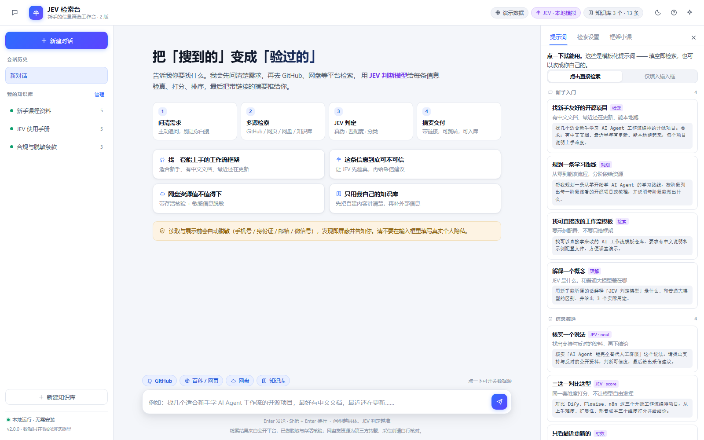

# JEV 检索台 · 2 版

> 用**对话**的方式筛选真实信息：先问清需求 → 多平台检索 → 用开源 **JEV（TypeSafe System One）** 判断模型验真、打分、排序 → 把带链接的摘要推给你。
> 目标用户是新手：界面里每一步都展开给你看，框架意识在看的过程中长出来。

- 版本：`v2.1.0`（2026-10-21）— 判定层已对齐官方 `/v1/systemone` 协议，接入三种真实后端
- 形态：**纯前端静态站点**，双击 `index.html` 就能跑；接真实模型时加一个零依赖本地代理
- 技术栈：原生 HTML / CSS / 经典 JavaScript（无框架、无构建工具；可选代理零依赖）
- 与 1 版的关系：**完全重写**。1 版是节点画布（`D:\网站检索\1版`），2 版是对话式主站，两者互不影响



---

## 一、它解决的问题

新手最容易踩的坑是：**搜到 ≠ 可信**。

搜索引擎给你 18 条结果，你不知道哪 3 条是真的、哪几条链接已经死了。
这个工作台把「筛选」拆成可观察的 5 步，并让一个专门的**判断模型**在岔路口做原子判断：

| 步骤 | 谁在干活 | 你能看到什么 |
|---|---|---|
| 1. 获取需求 | 主动问答 | 需求含糊时先追问一句，给出可点选项 |
| 2. 信息获取 | GitHub API / 网页 / 网盘 / 知识库 | 每个来源拿了几条、是实时还是演示 |
| 3. JEV 判定 | 一次调用问 3 个问题 | 真伪概率 p、匹配分、分类**同时返回** |
| 4. 打分排序 | 代码里的阈值与权重 | 综合分 = 匹配 ×0.7 + 真伪 ×3 |
| 5. 摘要展示 | 本地模板合成 | 结论 + 推荐顺序 + 风险提示 + 可点击链接 |

两个贯穿全程的工程习惯：

- **脱敏前置**：手机号 / 身份证 / 邮箱 / 微信号 / QQ 号在本地规则里就被替换成 `［已屏蔽］`，然后才参与判定与展示。
- **判断与生成分离**：JEV 只给概率与分数，「过不过」由阈值（代码里的配置）决定 —— 可复现、可审计、可解释。


---

## 二、快速开始

```text
双击  2版\打开网站.bat      （或直接双击 2版\index.html）
```

现代浏览器（Chrome / Edge / Firefox / Safari 16+）均可，首次打开自动写入 3 个示例知识库。
默认使用**本地启发式**判定：离线、确定性、每步可解释，适合第一次上课。

要跑**真实模型**，三条路任选（详见 [INSTALL.md](INSTALL.md)）：

| 路线 | 需要什么 | 适合谁 |
|---|---|---|
| A. 浏览器 ONNX（local-jev 方案） | 首次下载模型 ~200–300MB | 不想装服务、要数据不出本机 |
| B. 本地开源服务（ollaya / Laya） | 装 ollaya，拉 `laya:multilingual` | **推荐**：本机真模型、无需 API Key、中文可用 |
| C. TypeSafe 官方 API | API Key（放服务端 `.env`） | 要官方 `jev-latest` 的能力与校准 |

B / C 都走同一个零依赖代理：`node server\jev-proxy.js`（或双击 `启动JEV代理.bat`），
然后在界面「检索设置 → 判定引擎」里切换并点「测试连接」。

---

## 三、功能地图

### 对话主区

- **欢迎页**：四张示例卡，点一下就走完整条链路
- **思考过程**：可折叠，逐步显示「关键词 → 各源条数 → 脱敏/淘汰数 → JEV 保留/过滤 → 分类分布 → 后端名」以及每步耗时
- **结果卡片**：排名、来源徽章、匹配分与真伪概率条、分类、低置信标注、可点击小链接、**判定依据**（3 个问题的答案 + 概率分布 + 影响信号）、存入知识库
- **结果操作**：导出 Markdown / 复制摘要 / 重新检索
- **主动追问**：需求含糊时给 4-5 个可点选项（含「直接检索，不用追问」）

### 右侧「提示词工作台」

- 16 条内置模板，分 4 组：新手入门 / 信息筛选 / 提示词工程 / 知识库
- 点击模式可切换：**直接检索** 或 **仅填入输入框**
- 支持新建 / 编辑 / 删除自定义提示词（本地）
- 另有「检索设置」与「框架小课」两个标签页

### 左侧栏

会话历史（最近 10 个）、知识库列表与管理（新建 / 删除 / 逐条增删 / 一键把检索结果入库）。

### 检索设置

| 设置项 | 说明 |
|---|---|
| 检索模式 | 演示数据（不联网） / 实时检索（真的请求 GitHub 公开 API，失败回落） |
| 数据源 | GitHub / 百科网页 / 网盘 / 知识库 |
| 判定引擎 | 本地启发式 / 浏览器 ONNX / 本地开源服务或官方 API |
| 真伪阈值 | 0.30–0.90；全被筛掉时放宽展示 Top3 并提示 |
| 脱敏与安全 | 手机号、身份证、邮箱、微信号、仅 HTTPS |
| 对话习惯 | 跳过主动追问 |

---

## 四、目录结构

```text
2版/
├─ index.html
├─ css/app.css · css/panels.css
├─ js/
│  ├─ core.js            工具 / 脱敏 / 本地存储 / 设置中心
│  ├─ data.js            演示数据 / 知识库种子 / 问题模板
│  ├─ kb.js              知识库 CRUD
│  ├─ jev-protocol.js    官方协议层：问题编译 + 答案归一 + 置信度校准
│  ├─ jev-onnx.js        浏览器本地推理（移植 local-jev）
│  ├─ jev.js             判定调度：local / onnx / remote 三后端 + 降级
│  ├─ sources.js         关键词 / 多源检索 / 脱敏与硬规则预检查
│  ├─ pipeline.js        7 步业务流水线
│  ├─ promptlib.js       右侧提示词模板库
│  └─ app.js             界面主控
├─ server/jev-proxy.js   零依赖代理：ollaya / TypeSafe / OpenAI 兼容 / passthrough
├─ tools/
│  ├─ smoke-test.js      无浏览器冒烟测试（61 项）
│  └─ proxy-test.js      代理端到端测试（22 项，自带假上游）
├─ docs/                 截图
├─ env.example / .gitignore / 2 个 .bat
└─ README / INSTALL / ARCHITECTURE / CHANGELOG / TODO
```

---

## 五、关于 JEV（用前必读）

JEV 是 **TypeSafe AI 的 System One 决策模型**：不写文本，只回答**类型化问题**并返回带概率的结构化答案。

### 5.1 官方接口长什么样

```jsonc
// POST https://api.typesafe.ai/v1/systemone
{
  "state": "…待判断的数据…",
  "model": "jev-latest",
  "questions": {
    "veracity":  { "type": "noul",  "instructions": "是否真实存在？" },
    "relevance": { "type": "score", "levels": ["2 分…", "4 分…", "6 分…", "8 分…", "10 分…"] },
    "category":  { "type": "choice","criteria": { "教程": "…", "代码库": "…" } }
  }
}
// 响应
{ "model": "jev-1.13.0",
  "answers": {
    "veracity":  { "noul": 0.86 },                                  // noul 只有概率，无 confidence
    "relevance": { "score": 3.2, "probabilities": {…} },            // 分数可落在档位之间
    "category":  { "choice": "代码库", "probabilities": {…}, "confidence": 0.74 }
  },
  "usage": { "input_tokens": 318, "output_tokens": 34 } }
```

**关键点**：一个请求里的所有问题对同一 `state` **并行评估**，「加问题几乎不增加响应时间」；问题 key 由你命名、答案按同 key 返回、**key 不发给模型**。
所以本项目是**每条候选信息 1 次调用问 3 个问题**，而不是每个原语各发一次。

### 5.2 三种原语与硬限制（官方口径）

| 原语 | 语义 | 返回 | 限制 |
|---|---|---|---|
| `noul` | 是 / 否 | 单个 0–1 概率（**无 confidence 字段**） | — |
| `choice` | 单选 | 选项 + `probabilities` + `confidence` | **≤255 个选项**，>20 个时开源模型明显退化 |
| `score` | 有序评分 | 分值（可落在档位之间）+ 分布 + `confidence` | 2–10 级 |

上下文：请求 64k，`state` + 最长单问 ≤ 32k；仅文本输入；英文最佳，中文「能用但不同等」。
价格：$0.042 / 百万 input token（output 免费）。独立实测延迟 p50 ≈ 314ms。

### 5.3 我们遵循的两条工程结论

1. **别用官方 `confidence` 字段做置信判断**，用 `max(probabilities)`。本项目统一这样算，并在 `max(prob) < 0.55` 时给卡片打上「低置信 · 建议人工复核」。
2. **弃权率会吃掉成本优势**：实测约 30% 弃权时，成本优势从几十倍压到个位数倍。所以本项目把「不确定」显式暴露给你，而不是硬给一个答案。

### 5.4 开源实现（本项目实际参考/移植的）

| 项目 | 是什么 | 本项目怎么用 |
|---|---|---|
| [zhuanqianfish/local-jev](https://github.com/zhuanqianfish/local-jev) | 浏览器端 Jev：用 NLI 零样本模型把三原语变成概率，纯本地 ONNX，零 token | **移植**为 `js/jev-onnx.js`（可选后端） |
| [ollaya-dev/ollaya](https://github.com/ollaya-dev/ollaya) | 「决策模型的 Ollama」：本地守护进程，`/v1/systemone` **wire-identical 于 TypeSafe** | 代理默认上游；不装则回落到启发式 |
| [NandhaKishorM/laya](https://github.com/NandhaKishorM/laya) | Apache-2.0 自研决策模型（ModernBERT 系，约 421M，T4 33ms） | ollaya 里的 `laya:multilingual`，中文场景首选 |
| [datawhalechina/jev-cookbook](https://github.com/datawhalechina/jev-cookbook) | 中文教程：三原语 → 18 篇实战 → RLCD 微调 Laya | 语义与用法对照 |
| [Chorylee7/JEV](https://github.com/Chorylee7/JEV) | 调研报告：官方宣称 vs 独立实测、校准、风险清单 | 上面 5.2 / 5.3 的第三方数字来源 |

> **诚实声明**：仓库**不含**任何模型权重，也不会把自己伪装成真实模型。
> 默认的「本地启发式」是用可解释规则近似三原语的**行为契约**（同输入同输出、只给概率与分数、阈值在代码侧），每张卡片明确标注 `backend: local`；真实后端的答案会在「判定依据」里标注 `onnx` / `remote`，失败回落时标注原因。

---

## 六、数据与隐私

- 会话、知识库、设置只存在浏览器 localStorage（前缀 `jev2.`），不上传
- 选 ONNX 时推理完全在本机；选代理模式时数据只发往你自己配置的上游
- 演示数据为公开仓库或明确标注的示例条目，不代表任何平台真实检索结果
- 代码无真实密钥；`env.example` 只有占位符。若曾把 Key 写进仓库历史，请 `git filter-repo` 重构并轮换

---

## 七、验证

```powershell
cd 'D:\网站检索\2版'
node tools\smoke-test.js     # 61 项：脱敏 / 协议层 / 三后端 / 流水线 / 追问 / 知识库 / 提示词
node tools\proxy-test.js     # 22 项：代理转发官方形状、校验、兼容接口、上游不可用
```

浏览器侧已验证：首屏、完整检索链路、追问、深色主题、窄屏、控制台零报错；
**已验证** `transformers.js` 能从 CDN 在 `file://` 页面动态加载（ONNX 后端的加载机制可用）；
**未验证** ONNX 模型权重的完整下载与推理（需 ~280MB 且依赖 HuggingFace 可达），也未接真实 TypeSafe/ollaya（无 Key / 未装二进制）—— 读者按 INSTALL 配好后可自行验证。
